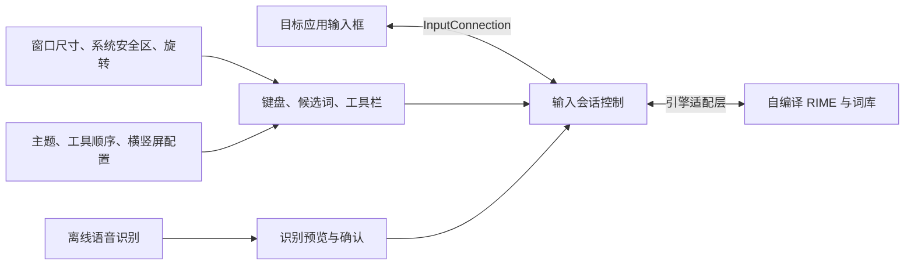

# 定制输入法设计与实施说明

> 历史调研记录：下文“定制 CyIME 分支 / 尚未开发”的结论已由后续要求取代。当前简心采用独立多模块工程，只固定引用输入引擎、词库和语音依赖；实际入口与功能状态请看 [项目说明](../README.md) 和 [开发指南](development.md)。

核查日期：2026-10-31。状态：已完成 APK 静态核查、上游源码抽查和方案设计；尚未开发、构建或实机验证定制 APK。

当前优先采用 **CyIME 定制分支，保留其现有 RIME、九键增强和离线语音**。新增项目的源码核查及实施顺序见 [CyIME 评估与路线更新](cyime-assessment.md)。用搜狗作为手感和交互参照，优先验证五个痛点并补齐实际差距。

本文保留搜狗与语燕的核查证据，以及导航、旋转、语音、工具栏的通用验收要求。下文涉及“语燕公开界面 + 新 RIME 桥接”、替换语燕闭源库和语燕文件改动入口的内容属于备选路线；CyIME 主线的工程入口和实施顺序以新增评估文档为准。

这条路线可以覆盖提出的五项需求，但不能预先保证 RIME 与搜狗的候选排序、纠错、长句输入和语音识别效果完全相同。这些体验需要单独调优和对比验收。

## 已核实的基础条件

| 对象 | 实测或源码事实 | 对方案的影响 |
| --- | --- | --- |
| 本地搜狗 APK | 包名 `com.sohu.inputmethod.sogou.oem`，版本 11.3 / 1621，minSdk 21、targetSdk 29 | 保留原包作体验参照，另做独立应用 |
| 标准原生库目录 | `lib/armeabi/` 下 30 个 `.so` 均为 ELF32 / ARM；没有 `lib/arm64-v8a/` | 修改 Manifest、ABI 目录名或重新签名不能生成 ARM64 机器码 |
| 额外输入核心 | `assets/raw/sogouime` 也是 ELF32 / ARM | 只替换标准目录下少数库仍不能迁移完整核心 |
| 离线语音资源 | `assets/offline_full_v5_32.zip` 内发现 8 个 ARM32 ELF 库 | 原包的离线语音也需要完整的 ARM64 实现 |
| 其他嵌入资源 | assets 中存在个别 ARM64、x86_64 辅助组件，例如 64 位手写组件 | 不能说整个 APK 没有任何 64 位文件；这些组件不构成完整 ARM64 应用 |
| 语燕应用工程 | 当前核查提交的应用配置为 ARM64、compileSdk / targetSdk 36 | 已具备现代 Android 工程基础，但不能据此认定所有依赖都合格 |
| 语燕 SDK | 作者说明公开部分是上层框架；预编译 `libyuyanime.so` 的核心修改源码未公开，并有包名和授权限制 | 单纯 fork、改应用包名、重打包不是独立定制方案 |

搜狗核查记录见 [APK 核查数据](evidence/apk-audit.json)。原 APK 的 SHA-256 为 `fdd8880bc8924f4aeeb7beefaa6167134398abf0abdcbbe7c8f866bd87ac019e`。本次未改写原包，也未对其进行完整 Java/Smali 反编译或运行测试。

语燕核查基线固定为应用提交 `75bd0aebb7c313858437195539445b82021904d1`，对应 SDK 子模块 `c99f9b7c451b7b77d379dab7d55fdbfb93b04b12`。截至此次查询，GitHub 最新发布版为 `v20260530.10`，它和上述源码基线不是同一个概念；用户手机中的版本仍待确认。依据：[应用构建配置](https://github.com/gurecn/YuyanIme/blob/75bd0aebb7c313858437195539445b82021904d1/app/build.gradle)、[SDK 说明](https://github.com/gurecn/yuyansdk/blob/c99f9b7c451b7b77d379dab7d55fdbfb93b04b12/README.md)、[发布版](https://github.com/gurecn/YuyanIme/releases/tag/v20260530.10)。

对 SDK 中五个 ARM64 库只读取 ELF 头和程序头，发现 `libyuyanime.so` 的 LOAD 段对齐为 16 KB，`libgpen_handwriter.so` 为 64 KB；`libSogouShell.so`、`libhandwriting.so`、`libhwInterface.so` 为 4 KB。详见 [原生库头检查](evidence/yuyan-native-audit.json)。这是静态检查，不代表整包已经通过 16 KB 运行测试。当前 SDK 树中未发现 C/C++ 构建源码，不能通过只更新 NDK 重新编译这些现成库。

## 路线选择

| 路线 | 能解决什么 | 剩余问题 | 选择 |
| --- | --- | --- | --- |
| 定制 CyIME，保留其 RIME 集成 | 已有 ARM64、工具栏排序、本地语音和导航区处理代码 | 尚须验证构建、Moto 适配、原生依赖和输入质量 | **当前优先路线；详见新增评估** |
| 修补搜狗 APK | 某些尺寸、资源和按钮位置可能可以修改 | 闭源原生核心、离线语音的 64 位重建没有源码；签名和后续维护成本高 | 仅适合作为旧设备上的局部实验 |
| 直接 fork 语燕并使用其全部预编译库 | 快速继承现有体验 | 包名绑定、闭源核心、部分库的 16 KB 适配无法独立维护 | 不作为独立产品的基础 |
| 语燕公开界面 + 自编译 librime | 保留较成熟的手机键盘界面，掌握核心构建与包名 | 需要新 JNI 适配；九键选音、联想等定制能力需要重新实现或替换 | 备选路线 |
| 从 librime 自建全部 Android 界面 | 完整控制各层 | 候选栏、按键、主题、编辑、剪贴板和生命周期工作量更大 | 如果公开界面迁移成本过高，再采用 |

RIME 是输入引擎，不是完整 Android 输入法；语音也不属于它的职责。自编译上游时需要一并构建依赖、JNI 和适用的词库方案。公开代码及依赖保留各自版权说明；不能把仓库顶层 BSD 标识当作所有预编译库或模型的授权依据。[librime 项目](https://github.com/rime/librime)

## 产品组成与输入行为

主界面包含候选词区域、可调整的工具栏、键盘主体、用户额外留白和系统导航安全区。初始工具顺序建议为“剪贴板、表情、语音、编辑、更多”，用户可调整。输入拼音时优先显示候选词，同时保留可达的语音或更多入口。

第一版保留九键、全拼和已有双拼界面的迁移目标；先以全拼验证新核心，再逐项接通九键选音、简拼、中英混输、用户词频和双拼配置。若用户主用九键，九键通过验收是进入日常使用版本的必要条件。

主题可调整按键高度、间距、字体、长按时间、振动、深浅色和工具栏密度。桌面图标可在完成启用后隐藏，但必须保留输入法内设置入口及系统输入法设置入口。独立应用名、包名和发布签名从第一个可安装版本开始固定；测试包另用后缀，避免覆盖现用输入法。

## 全面屏与 Moto 工作空间

目标是让导航条可见时键盘仍然贴合、可点击且不多出空白。系统要求显示的横条不属于输入法能保证隐藏的内容，也不需要隐藏才能达成兼容。

设计为“自动避让 + 用户额外间距”，额外间距初值为 0，可提供 0–48 dp 的初始调节范围，横竖屏分别保存。系统安全区和用户留白在设置中分开解释，避免把不可点击的系统区域当成键盘高度。

实现约束：

- 从 IME 当前窗口获取 navigation bar / display cutout 等 Insets，覆盖底部及横屏时左右侧的情况；手势冲突区域按需纳入触控约束。
- 明确哪个容器消费系统 Insets。同一段空间只计算一次；如果框架已经避让，则只补剩余部分。不能直接把各类重叠 Insets 相加。
- 不用 IME 自己的高度作为自己的底部 padding，避免高度反馈循环；不依赖固定的“导航条高度”资源值。
- 自动适配模式不主动隐藏系统导航栏。背景延伸和明暗图标在系统允许的范围内与键盘统一；OEM 强制对比色作为实际设备表现处理。
- 自定义“全面屏功能栏”是额外功能，不等同于系统横条；默认不增加第二条占高栏。
- 工作空间保持开启进行验收。需要先辨认它属于 Moto 自带隔离空间、Android 工作资料还是其他功能，不能预设它们的窗口行为一致。

现有 `InputView.initNavbarBackground()` 在 Android 11 及以上主动调用隐藏导航栏，且 Insets 监听只记录 bottom；`initView()` 与 Insets 监听对横屏是否增加功能栏高度的条件也不一致。这些是要调整的具体位置，不是已经验证的 Moto 根因。[已核查源码](https://github.com/gurecn/yuyansdk/blob/c99f9b7c451b7b77d379dab7d55fdbfb93b04b12/src/main/java/com/yuyan/imemodule/keyboard/InputView.kt)

## 横竖屏、分屏与触摸区域

上游存在“从 B 站横屏输入切回竖屏应用后保留横屏布局”的报告，与用户描述相近，但不是同一台设备的复现证据。[Issue #897](https://github.com/gurecn/YuyanIme/issues/897)

源码检查发现：`onConfigurationChanged()` 使用独立协程固定延时 200 ms 后刷新；`InputView.setConfiguration()` 是空实现；窗口尺寸保存在全局环境对象；输入根视图被复用；`getKeyboardRect()` 手工叠加高度，未始终与可见内容一致。上游已经关闭横屏全屏提取模式，所以再加一次 `onEvaluateFullscreenMode() = false` 不足以解决问题。[服务源码](https://github.com/gurecn/yuyansdk/blob/c99f9b7c451b7b77d379dab7d55fdbfb93b04b12/src/main/java/com/yuyan/imemodule/service/ImeService.kt)

采用一个窗口布局协调器：

1. 配置变化、窗口显示、输入目标切换、Insets 变化和实际尺寸变化都触发重新检查。
2. 以当前 IME 窗口可用边界和已测量根视图为依据；不把应用级 `displayMetrics` 或物理屏幕宽高当作唯一依据。API 兼容路径统一输出布局输入。
3. 用窗口边界、显示器、密度、字体缩放、Insets、布局模式和用户配置生成布局版本。旧版本的延迟回调失效；协程随服务销毁取消。
4. 根据布局版本重新计算按键、候选栏、工具栏、底部空间和浮动位置，再刷新相关缓存。用真实布局回调衔接，取消“等 200 ms 就认为屏幕稳定”的假设。
5. 横竖屏分别保存高度、单手模式和悬浮位置。悬浮坐标以可用区域比例保存，恢复时限制在当前边界内。
6. `onComputeInsets()` 与触摸区域采用同一套实际窗口坐标和可见矩形。停靠键盘、浮动键盘分别处理；键盘外的应用区域应继续响应触摸。[Android IME API](https://developer.android.com/reference/android/inputmethodservice/InputMethodService)

布局状态和文字会话状态分离。同一输入框旋转时尽量保留未上屏拼音和候选选择，不能为了修复显示而清空所有文字；切换到另一输入框则终止旧会话。新的 `InputConnection` 必须重新绑定，迟到的候选结果和语音结果不得写入新输入框。

## ARM64 与后续 Android 兼容

“高版本 Android”与“禁止运行 32 位应用”不是同义词。安装问题要根据设备支持的 ABI、安装错误及系统策略确认。定制版本以 `arm64-v8a` 为主；模拟器可按需增加 `x86_64`，不为其他 ABI 打包无法提供完整依赖的半成品。[Android 64 位指南](https://developer.android.com/games/optimize/64-bit)

新引擎使用独立 JNI 桥接到上游 RIME C API，管理会话、输入、候选、提交和选项。上游 SDK 的 `replaceRimeKey`、`getRimeAssociateList` 等定制接口需要明确替代行为，不能仅把一个新 `.so` 改成旧库名。可用标准输入/光标接口加独立的九键与联想逻辑实现；按实际锁定版本检查 API 可用性。[RIME C API](https://github.com/rime/librime/blob/master/src/rime_api.h)

将 RIME 调用串行化到受控执行线程，UI 只处理结果；词库部署与语音模型初始化不阻塞按键线程。布局重建不应反复重新部署词库。

构建基线使用已核查的 API 36 工程作为起点，最低 API 暂保留上游 23；工具链采用支持目标 API 的固定版本，满足 AGP 8.5.1 以上和 NDK r28 以上的 16 KB 构建条件，同时验证所有第三方预编译依赖。库的 ELF 对齐和 APK 中未压缩库的 ZIP 对齐是两件事，不能只执行 `zipalign` 就认定完成。[Android 16 KB 指南](https://developer.android.com/guide/practices/page-sizes)

闭源手写库不进入独立构建的必需依赖。若后续要保留手写，需要取得适用的可维护版本或接入可自行构建的替代实现；其工作不能伪装成已经随 RIME 迁移完成。原生依赖升级后必须重新检查 ARM64、16 KB 加载和运行行为。

## 工具栏与表情、剪贴板

工具栏应支持拖动排序、隐藏、恢复默认、固定常用项、溢出菜单以及配置导入导出。按稳定动作 ID 保存配置，避免枚举顺序变化把“表情”变成其他功能。横竖屏默认共用顺序，但可以分别配置显示数量或独立布局；升级不得覆盖用户配置。

语燕已实现菜单面板拖动排序与固定到顶部的能力，可以复用交互；顶部工具条仍需完善。当前 `SkbFunDao.getALlBarMenu()` 没有 `ORDER BY position`，固定项目的写入也没有完整的排序流程。应对工具条增加显式顺序、迁移规则和批量事务，完成拖动后一次保存。[现有菜单逻辑](https://github.com/gurecn/yuyansdk/blob/c99f9b7c451b7b77d379dab7d55fdbfb93b04b12/src/main/java/com/yuyan/imemodule/keyboard/container/SettingsContainer.kt)、[现有查询](https://github.com/gurecn/yuyansdk/blob/c99f9b7c451b7b77d379dab7d55fdbfb93b04b12/src/main/java/com/yuyan/imemodule/database/dao/SkbFunDao.kt)

“更多/设置”的恢复入口始终可达。顺序去重、未知动作忽略、新增功能进入更多菜单；损坏配置恢复默认并提示，不使键盘失去入口。

表情分为 Unicode emoji、颜文字和用户导入的本地图片表情。图片通过 Android 富媒体输入接口发送，需要目标应用支持对应 MIME 类型；不能承诺所有 App 都能直接接收图片。搜狗在线表情商店和私有资源不作为必需依赖。[Android 图片键盘接口](https://developer.android.com/develop/ui/views/touch-and-input/image-keyboard)

剪贴板保留历史、置顶、搜索及清除设置。密码框关闭历史推荐、个性化学习和语音；尊重应用的禁止个性化学习请求。工作空间不得默认与个人场景共享历史；如果当前系统无法可靠区分上下文，采用关闭历史的保守模式及明确的手动隐私模式，不承诺已经实现自动隔离。系统工作资料的输入法许可与跨资料限制需要在目标机验证。[Android 设备策略接口](https://developer.android.com/reference/android/app/admin/DevicePolicyManager#setPermittedInputMethods(android.content.ComponentName,%20java.util.List%3Cjava.lang.String%3E))

## 语音输入

默认按“离线可用、联网可选”设计，普通话作为首个待验证语言，粤语及其他语言按实际需求增加。RIME 处理打字；语音识别引擎返回文字后经同一个输入会话控制器上屏。

| 实现 | 优点 | 限制与定位 |
| --- | --- | --- |
| 内置 sherpa-onnx 本地识别 | 无需依赖手机预装服务；可自行构建 ARM64 版本 | 必须交付模型；需要测内存、速度、温升和识别率，作为推荐主方案 |
| 系统 SpeechRecognizer | 接入较快，可作轻量扩展 | 不保证所有 Moto、工作空间或无 Google 服务设备都有可用服务；不能作为唯一方案 |
| 可选联网识别 | 可用于用户偏好的服务或较强识别模型 | 需要用户显式启用，说明服务和数据去向，不自动作为离线失败时的后备 |

sherpa-onnx 提供 Android 本地运行路径。原型阶段比较中文流式 Zipformer 与 SenseVoice int8：前者适合边说边显示，后者可按短句/VAD 分段识别并提供多语言选择。不能把非流式模型按段输出误称为逐字流式，也不预先承诺哪一个在用户 Moto 上更快。[Android 本地识别](https://k2-fsa.github.io/sherpa/onnx/android/index.html)、[中文流式模型](https://k2-fsa.github.io/sherpa/onnx/pretrained_models/online-transducer/index.html)、[SenseVoice](https://k2-fsa.github.io/sherpa/onnx/sense-voice/pretrained.html)

交互为“点麦克风开始 → 显示录音状态与识别预览 → 停止 → 确认插入或取消”。预览不应反复向应用提交完整句子，最终结果只提交一次；已有拼音组合时先处理当前组合，不丢字。之后可增加长按空格说话，但要处理空格长按原有功能的冲突。

权限通过可见设置/授权页面申请。首次授权返回后重新确认输入会话有效，不拿旧 `InputConnection` 继续录音上屏。切换应用、隐藏键盘、撤回权限、来电或录音失败时停止采集；旋转时保留语音界面状态，无法安全保持会话时停止录音并保留待确认预览。

识别任务绑定 editor session ID，所有回调校验会话；音频默认不保存，诊断日志不记录输入文字或语音内容。实际录音、推理及模型加载不占用 UI 主线程。按压力释放模型，并提供“语音不可用时仍可正常打字”的退化路径。

纯离线构建不带联网权限，并只使用可验证的本地识别路径；模型通过本地导入或提供含模型的安装包交付，校验文件完整性。可选联网构建单独配置。模型许可与推理框架许可分别记录。

系统识别适配器先检查服务和语言支持。API 31 起的专用端侧接口需检查设备可用性；通用接口的 `EXTRA_PREFER_OFFLINE` 可能被实现忽略。即使本应用没有联网权限，被调用的外部识别服务也不能自动当作离线服务。[SpeechRecognizer](https://developer.android.com/reference/android/speech/SpeechRecognizer)、[RecognizerIntent](https://developer.android.com/reference/android/speech/RecognizerIntent#EXTRA_PREFER_OFFLINE)

## 保留搜狗体验的方式

先收集用户最常用的真实输入场景，分别比较搜狗、原版语燕和定制版本。重点记录首选词、选词次数、改字次数、九键选音步骤、长按操作及中英数字混输行为，不只比较截图。

可以重现按键尺寸、色彩、震动、候选区密度、符号入口和操作顺序。词库从可维护的公开 RIME 方案中选择基线，并接入用户主动导出的个人词条；原搜狗的私有二进制词库、预测算法和语音模型不能假定能无损转用。词频和联想需要用日常样例验证，不以“换上 RIME”代替体验验收。

用户仍待提供：Moto 型号、Android 版本、当前语燕版本、工作空间的具体类型、主用输入方案、最希望保留的搜狗体验，以及语音的离线偏好/语言。这些信息影响测试机配置与优先级，不影响当前独立核心、布局和模块边界的设计。

## 实施顺序与交付

| 阶段 | 实际工作 | 交付与通过条件 |
| --- | --- | --- |
| 0：独立核心验证 | 锁定源码与依赖，移除受限二进制依赖路径，新 JNI 与 RIME，独立应用身份 | 用自己的包名、签名构建 ARM64 APK；断网完成全拼输入、选词、删除、上屏；检查 16 KB 加载；确认不依赖旧闭源库 |
| 1：窗口和旋转修复 | 窗口布局协调器、Insets 统一消费、实际触摸矩形、缓存失效 | 开启 Moto 工作空间完成横竖屏及跨应用回归；无重叠、无重复留白、无全屏透明层吞触摸 |
| 2：输入体验与工具栏 | 接通主用输入方案、九键必要逻辑、可排序工具栏、主题、剪贴板、表情 | 排序跨重启和升级保留；主用输入场景可替代日常键盘；图片发送在支持的 App 中验证 |
| 3：语音 | 两个模型候选在目标机对比，接入一种稳定本地方案，完成权限和会话处理 | 交付 APK 及匹配模型或含模型安装包；飞行模式可识别，取消不插入，切换输入框无串写 |
| 4：日常稳定版 | 回归、签名升级、备份恢复、诊断信息与使用说明 | 固定发布签名可升级且配置保留；完整交付源码、依赖锁定信息、构建命令、校验值和实机测试记录 |

阶段 0 是首个关键关口。若公开界面对闭源引擎的耦合过深，应在这里调整界面复用范围；不要先花大量时间做皮肤再发现核心无法独立运行。九键选音和联想实现是另外的主要工作量，不能隐藏在“替换核心”一句话里。

建议实现边界如下；这表示模块职责，可以先以包实现，避免为了拆模块增加不必要的 Gradle 工程：

| 职责 | 建议位置 | 改动入口 |
| --- | --- | --- |
| Android 服务、会话绑定 | `ime-runtime` | `ImeService`、输入事件与提交路径 |
| 实测窗口布局、安全区、旋转 | `ime-layout` | `EnvironmentSingleton`、`InputView`、键盘尺寸缓存 |
| 核心接口与自编译桥接 | `engine-rime` | `Rime.kt`、`RimeEngine`、`CustomEngine` |
| 工具栏顺序与入口 | `toolbar` | `CandidatesBar`、`SettingsContainer`、`SkbFunDao` |
| 本地语音与可选服务 | `speech` | 新 `SpeechEngine` 接口、录音预览面板、生命周期 |
| 主题、用户布局与备份 | `preferences` | 现有配置入口、数据版本迁移 |

## 验收矩阵

以下都是待执行的验收要求，不是已通过的测试结果。

| 场景 | 操作 | 通过标准 |
| --- | --- | --- |
| 导航与工作空间 | 工作空间开/关；手势导航与三键导航；额外间距 0/中间/最大值 | 不覆盖系统交互区、不重复增高；背景合理；按钮实际触点与显示一致 |
| 旋转 | 竖→横→竖连续 100 次；有/无未上屏拼音；键盘打开/关闭两种起点 | 无残留横屏宽度、错位、崩溃或输入内容重复提交 |
| 跨应用 | 横屏视频内打开弹幕输入，再切竖屏聊天/浏览器；快速往返 | 首次稳定布局后尺寸正确，键盘外点击仍有效 |
| 窗口变化 | 分屏拖动、显示缩放、单手、悬浮、实体键盘连接/断开 | 位置在窗口内，候选区及触摸区域同步变化 |
| 原生兼容 | ARM64 仅 64 位运行环境；4 KB 与 16 KB 环境；冷启动及词库部署 | 安装、加载、打字、语音均可用；不把兼容模式弹窗当作原生适配通过 |
| 工具栏 | 拖动表情/剪贴板/语音，隐藏，恢复默认，重启，再升级 | 顺序一致，无重复/丢失操作，设置入口可达 |
| 语音 | 普通话日常短句、中英混合；拒绝授权、断网、切屏、切输入框、取消 | 可用路径识别成功；仅向当前有效会话提交一次；无授权时键盘正常工作 |
| 输入质量 | 用用户常用语句集对比；包含姓名、地名、英文、数字、简拼和错拼 | 记录选词和纠错差距，确定用户可接受结果后才作为主力输入法 |
| 数据与升级 | 升级 APK、导出/导入布局及词条；密码框和工作空间 | 配置可恢复；不记录密码输入；工作场景无非预期历史暴露 |

性能先记录基线，再设目标：热启动键盘显示延迟、按键到候选更新的 P50/P95、语音停止到最终结果时间、峰值内存和连续语音温升。在型号和模型未确定前不承诺固定毫秒数或模型大小。开启长时间语音不应使普通打字卡顿或发生 ANR。

接入真机后先收集型号、SDK、ABI 和页大小，以及复现时的布局日志。日志仅记录窗口边界、Insets、布局版本、模式和时间，不记录输入文本；当前环境尚无 Android SDK、可用 JDK 或 adb，因此本轮没有执行任何安装、构建或设备测试。

当前交付的是设计与可追溯的静态证据。最终“问题已解决”的判断以独立构建的 APK 在目标 Moto 及上述回归场景中通过为准。
