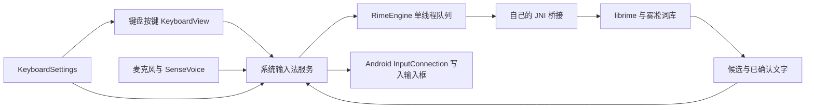

# 简心开发指南

## 一次输入经过哪些文件



`app/.../ime/JianxinInputMethodService.java` 负责与 Android 打交道，连接键盘、RIME 和语音。界面不直接修改词库，语音模块也不直接向任意输入框写字。切换输入框时会更换会话编号，旧识别结果不能写入新输入框。

`engine-rime` 使用一条后台队列完成词库准备、中文处理、候选选择及关闭，回到主线程更新界面。首次启用会把资源复制到应用内部目录并部署 RIME，期间显示准备提示。用户学习数据与随包字典分目录存放，升级资源时不覆盖用户词库。

配置改变时，Android 的 `InputMethodService` 会重新创建输入视图。简心保留 `super.onConfigurationChanged` 的流程，再读取当前安全区域，避免重复替换刚显示的视图。参照 [Android API 说明](https://developer.android.com/reference/android/inputmethodservice/InputMethodService#onConfigurationChanged(android.content.res.Configuration))。

## 想修改某项功能，去哪里

路径中的 Java 包都以 `indi/tatenlee/inputmethod/` 开头。

| 想做的修改 | 入口 |
| --- | --- |
| 应用名、版本、包名 | `app/src/main/res/values/strings.xml`、`app/build.gradle.kts`；包名发布后尽量不再改 |
| 键盘颜色 | `keyboard/.../keyboard/KeyboardPalette.java` |
| 键位、表情、符号 | `keyboard/.../keyboard/KeyboardView.java` |
| 按键形状、删除长按 | `keyboard/.../keyboard/KeyButton.java` |
| 工具栏项目与默认顺序 | `core/.../core/ToolbarAction.java` |
| 默认高度、底部距离、九键开关 | `settings/.../settings/KeyboardSettings.java` |
| 设置页和排序交互 | `app/.../settings/SettingsActivity.java` |
| 导航横条、旋转与安全区域 | `app/.../ime/ImeLayout.java` 和 `JianxinInputMethodService.java` |
| 高度限制计算 | `core/.../core/KeyboardGeometry.java`，单位为 dp |
| 密码框、数字框与回车动作 | `app/.../ime/EditorPolicy.java` |
| 中文方案 | `engine-rime/schemas/` |
| RIME 命令及候选数据 | `engine-rime/.../engine/RimeEngine.java`、`src/main/cpp/rime_bridge.cpp` |
| 语音模型参数 | `speech/.../speech/SenseVoiceDecoder.java` |
| 录音时限、取消、内存释放 | `speech/.../speech/OfflineSpeech.java` |
| 依赖更新 | `third_party/versions.json` 和 `scripts/prepare.py` |

## 几个重要约定

- **导航区域只取一次。** 系统导航、强制手势和可点击区域可能描述同一块空间，取最大值。用户额外留白再单独相加。横竖屏设置分别保存；Moto 的系统横条仍由系统管理。
- **窗口尺寸不能缓存成常量。** 旋转、分屏或切换显示区域后重新测量和处理 Insets。输入视图销毁不等同于输入引擎立即销毁。
- **设置保存稳定 ID。** 工具栏保存 `emoji / clipboard / voice / settings`，不保存中文名称或数组下标。未知项目会过滤，新增项目自动补齐。
- **输入框有边界。** 会话编号用于丢弃过期回调；密码与无个性化学习输入使用单独禁用用户字典的 RIME 方案。
- **模型按需加载。** 语音识别在后台执行，录音最长 30 秒，取消后不提交结果，闲置 30 秒释放模型。APK 较大主要因为内置离线模型。
- **不要直接改下载的依赖。** `third_party/librime` 等目录由脚本恢复，自己的改动应写在本工程适配层。必要的上游修补应变成有来源和说明的补丁文件。
- **离线和无桌面入口是构建约定。** `app/build.gradle.kts` 在打包前核查合并后的 Manifest：只允许麦克风权限，禁止 Launcher 类别和共享 UID。`scripts/check-apk.py` 再检查最终安装包，并扫描常见网络 API 引用及原生库网络导入。
- **裁剪依赖时保护 JNI 和测试入口。** `app/proguard-rules.pro` 保留自己的类名、sherpa JNI 配置类和测试共享的 Kotlin 运行时，未使用的 URL 读取方法被裁剪。测试 APK 的两个编译期注解忽略规则独立存放，不影响应用的缺失类检查。升级依赖后必须运行 Android 原生测试。

## 怎样跟进 CyIME 和 RIME

简心不是 CyIME 应用仓库的定制分支，没有需要持续合并的几千行输入法服务。当前输入内核固定到 CyIME 核查时选用的 Xime librime 提交，但应用代码、JNI、九键方案和界面均独立维护。

日常更新按单项功能进行：先看上游变更解决什么问题，再决定是否采用。更换引擎或模型时更新版本锁与校验值，记录来源与许可证，执行中文回放、Android JNI / 语音集成测试、APK ABI / 16 KB 对齐检查，最后做手机回归。不要让构建脚本直接下载浮动的 `main` 或 `latest`。

基础九键用拼写映射把字母映射到 2–9。它适合验证完整链路，后续提升方向是九键拼音筛选、模糊音、纠错和常用句排序，需要用你的日常输入样本衡量。CyIME 的增强实现可作为逐项移植来源，不能把换了 RIME 引擎等同于已经拥有搜狗的输入体验。

## 验证入口

`core/src/test` 检查设置恢复、会话过期与几何规则。`engine-rime/src/main/cpp/engine_check.cpp` 用实际 RIME 回放全拼与九键。`app/src/androidTest` 在 Android ARM64 进程中加载最终 JNI、词库和语音模型，识别公开音频样本。

`OfflinePolicyTest` 另外验证安装后的权限、IPv4/IPv6 TCP/UDP 套接字拒绝、LauncherApps 列表以及系统输入法设置入口。运行时不联系外部服务器。先把测试设备切到 AOSP 键盘，避免输入法服务和原生测试同时占用 RIME。

模拟器脚本 `scripts/start-emulator.py` 使用项目内的 Android 15 ARM64 AVD，要求 SDK 已安装对应系统镜像和 emulator。测试命令务必指定设备序列号，避免更改实体手机的默认输入法：

```sh
adb -s emulator-5554 install -r app/build/outputs/apk/debug/app-debug.apk
adb -s emulator-5554 install -r app/build/outputs/apk/androidTest/debug/app-debug-androidTest.apk
adb -s emulator-5554 shell am instrument -w -r \
  indi.tatenlee.inputmethod.test/androidx.test.runner.AndroidJUnitRunner
```

已确认目标设备为 Moto X40、Android 16，使用 Shelter 工作空间。实机重点检查：工作空间开启且横条常驻、横屏视频弹出键盘再回竖屏、反复旋转、语音中途切换应用、密码框、不同输入框的回车行为，以及实际中文候选排序。模拟器结果不能替代这些设备验收。

`scripts/moto-work-profile.py` 是电脑端的 ADB 配置工具，独立于输入法 APK；使用说明见 [工作空间导航配置](moto-work-profile.md)。它不要求简心获得系统设置权限。写入边界回归运行 `python3 scripts/test-work-profile.py`。
